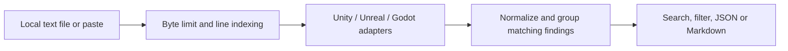

<div align="center">

# ShaderTriage

### Local shader build log review for Unity, Unreal Engine, and Godot.

**Drop a text log. Group repeated diagnostics. Export a report.**

[Open the live app](https://ghostnever-lkm.github.io/shader-triage/) · [Download the latest release](https://github.com/GhosTnever-lkm/shader-triage/releases/latest) · [Report an issue](https://github.com/GhosTnever-lkm/shader-triage/issues)

</div>

ShaderTriage is a small static web app for reviewing common shader compiler messages without sending a log to a server. It supports a selection of recognizable Unity, Unreal Engine, and Godot log forms. It groups matching lines, keeps their original text and line numbers, and exports JSON or Markdown.

The parser is deliberately conservative: unrecognized diagnostic-looking lines remain `unknown`; the app does not guess root causes or claim to understand every engine version.

## Quick start

Use the [live app](https://ghostnever-lkm.github.io/shader-triage/) or download the complete ZIP from [Releases](https://github.com/GhosTnever-lkm/shader-triage/releases/latest). For a local checkout, serve the project folder over localhost:

```powershell
py -m http.server 8000
```

Open `http://localhost:8000`, then drop a `.log`, `.txt`, or `.out` file, paste text, or load the built-in sample. Direct `file://` use is not supported because the app uses JavaScript modules and Web Crypto.

## What it shows

- Known shader compile errors, warnings, compile summaries, variant counts, and debug paths from supported log patterns.
- A normalized engine/severity view, a confidence label, source line numbers, and the original first line for each group.
- Search across message, shader, material, path, platform, and raw text, with engine and severity filters.
- JSON and Markdown reports. JSON export contains the full report regardless of visible search filters.
- Unity `compiled N variants` counts and their reported CPU time as separate metrics. Shader job CPU time is **not** wall-clock build duration.

## Supported patterns and limits

The parser recognizes selected forms, including Unity `Compiling shader`, `Compiled shader`, `STRIPPING`, and shader error/warning lines; Unreal `LogShaderCompilers` diagnostics and `Saved/ShaderDebugInfo` paths; and Godot shader compilation errors with `res://` locations or shader-specific GLSL messages.

- One UTF-8 text file or pasted log, up to 20 MiB.
- CRLF, LF, CR, and UTF-8 BOM are accepted; the original line text is retained in findings.
- A diagnostic group is based on normalized parsed fields. Similar-looking messages may be separate, and unrelated source issues may group if their parsed fields match.
- CPU time and variant totals are shown only when a recognized line reports them. They can be incomplete, repeated, or build-configuration-specific; they are not a measure of total build time or runtime GPU cost.
- A line marked `unknown` is not interpreted. Parser coverage depends on engine version, platform, logging settings, and the exact format.
- The app does not compile shaders, inspect project files, calculate a root cause, or modify source logs.

## How the app works



The live app uses only files hosted with this repository. Analysis runs in the browser tab; it has no API, analytics, remote fonts, or upload endpoint.

## Development

Requires Node.js 20+ for the regression suite. There are no runtime or development package dependencies.

```powershell
npm test
npm run check
```

## ☕ Support / Pro Version

ShaderTriage is free and open source under MIT. There is no separate paid Pro edition at this time. Optional support: [Buy Me a Coffee](https://buymeacoffee.com/azizazimov8) · [Boosty](https://boosty.to/azizazimov) · [Gumroad](https://azimovian22.gumroad.com/).

USDT on TRON (TRC20): `TCBSy38X57hA6w2onJcxom24x1febc1mP1`. Send only USDT on TRON to this address.

## License

MIT. See [LICENSE](LICENSE).

## References

- [Unity Manual: Check how many shader variants your build has](https://docs.unity3d.com/2023.2/Documentation/Manual/shader-how-many-variants.html)
- [Unreal Engine: Debugging the Shader Compile Process](https://dev.epicgames.com/documentation/en-us/unreal-engine/debugging-the-shader-compile-process-in-unreal-engine)
- [Godot: Shader language](https://docs.godotengine.org/en/stable/tutorials/shaders/shader_reference/shading_language.html)
